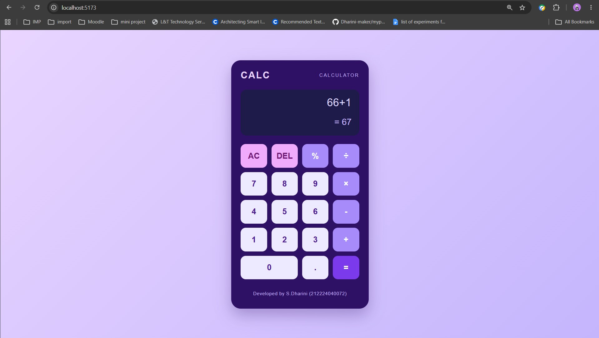

# Ex04 Simple Calculator - React Project
## Date: 17-11-2026
## Name : Dharini.S
## Reg No : 212224040072

## AIM
To  develop a Simple Calculator using React.js with clean and responsive design, ensuring a smooth user experience across different screen sizes.

## ALGORITHM
### STEP 1
Create a React App.

### STEP 2
Open a terminal and run:
  <ul><li>npx create-react-app simple-calculator</li>
  <li>cd simple-calculator</li>
  <li>npm start</li></ul>

### STEP 3
Inside the src/ folder, create a new file Calculator.js and define the basic structure.

### STEP 4
Plan the UI: Display screen, number buttons (0-9), operators (+, -, *, /), clear (C), and equal (=).

### STEP 5
Create a new file Calculator.css in src/ and add the styling.

### STEP 6
Open src/App.js and modify it.

### STEP 7
Start the development server.
  npm start

### STEP 8
Open http://localhost:3000/ in the browser.

### STEP 9
Test the calculator by entering numbers and operations.

### STEP 10
Fix styling issues and refine content placement.

### STEP 11
Deploy the website.

### STEP 12
Upload to GitHub Pages for free hosting.

## PROGRAM
 
 App.jsx
 ```

import { useState } from "react";
import "./App.css";

function App() {
  const [input, setInput] = useState("");
  const [result, setResult] = useState("");

  const handleClick = (value) => {
    if (value === "=") {
      calculate();
    } 
    else if (value === "AC") {
      setInput("");
      setResult("");
    } 
    else if (value === "DEL") {
      setInput((prev) => prev.slice(0, -1));
      setResult("");
    } 
    else {
      setInput((prev) => prev + value);
      setResult("");
    }
  };

  const calculate = () => {
    try {
      if (!input) return;

      const answer = eval(input);

      if (!Number.isFinite(answer)) {
        setResult("Error");
      } else {
        setResult(answer);
      }
    } 
    catch {
      setResult("Error");
    }
  };

  const buttons = [
    "AC", "DEL", "%", "/",
    "7", "8", "9", "*",
    "4", "5", "6", "-",
    "1", "2", "3", "+",
    "0", ".", "="
  ];

  return (
    <div className="calculator">

      <div className="calculator-header">
        <span className="brand">CALC</span>
        <span className="mini-text">CALCULATOR</span>
      </div>

      <div className="display">

        <div className="expression">
          {input || "0"}
        </div>

        <div className="answer">
          {result !== "" ? `= ${result}` : ""}
        </div>

      </div>

      <div className="buttons">

        {buttons.map((button) => (
          <button
            key={button}
            onClick={() => handleClick(button)}
            className={`
              ${button === "=" ? "equals" : ""}
              ${["+", "-", "*", "/", "%"].includes(button)
                ? "operator"
                : ""}
              ${["AC", "DEL"].includes(button)
                ? "special"
                : ""}
              ${button === "0" ? "zero" : ""}
            `}
          >
            {button === "*" ? "×" : button === "/" ? "÷" : button}
          </button>
        ))}

      </div>

      <div className="footer">
        Developed by S.Dharini (212224040072)
      </div>

    </div>
  );
}

export default App;
```

App.css

```

* {
  margin: 0;
  padding: 0;
  box-sizing: border-box;
}

html, body, #root {
  width: 100%;
  min-height: 100%;
}

body {
  font-family: Arial, sans-serif;
  background: linear-gradient(135deg, #e9d5ff, #c4b5fd);
  min-height: 100vh;
}

#root {
  min-height: 100vh;
  width: 100%;
  max-width: none;
  margin: 0;
  padding: 0;
  display: flex;
  justify-content: center;
  align-items: center;
}

.calculator {
  width: 320px;
  padding: 22px;
  background: #2e1065;
  border-radius: 22px;
  box-shadow: 0 15px 35px rgba(46, 16, 101, 0.3);
}

.calculator-header {
  display: flex;
  justify-content: space-between;
  align-items: center;
  margin-bottom: 20px;
}

.brand {
  color: #e9d5ff;
  font-size: 22px;
  font-weight: bold;
  letter-spacing: 2px;
}

.mini-text {
  color: #c4b5fd;
  font-size: 11px;
  letter-spacing: 2px;
}

.display {
  background: #1e1b4b;
  min-height: 100px;
  padding: 18px;
  border-radius: 14px;
  margin-bottom: 20px;
  text-align: right;
  overflow-wrap: anywhere;
}

.expression {
  color: #ddd6fe;
  font-size: 25px;
  min-height: 35px;
}

.answer {
  color: #c4b5fd;
  font-size: 20px;
  margin-top: 10px;
}

.buttons {
  display: grid;
  grid-template-columns: repeat(4, 1fr);
  gap: 10px;
}

button {
  height: 55px;
  border: none;
  border-radius: 12px;
  background: #ede9fe;
  color: #4c1d95;
  font-size: 19px;
  font-weight: bold;
  cursor: pointer;
  transition: 0.2s;
}

button:hover {
  background: #c4b5fd;
  transform: scale(1.05);
}

button:active {
  transform: scale(0.95);
}

.operator {
  background: #a78bfa;
  color: white;
}

.operator:hover {
  background: #8b5cf6;
}

.special {
  background: #f0abfc;
  color: #701a75;
}

.special:hover {
  background: #e879f9;
}

.equals {
  background: #7c3aed;
  color: white;
}

.equals:hover {
  background: #6d28d9;
}

.zero {
  grid-column: span 2;
}

.footer {
  color: #c4b5fd;
  text-align: center;
  font-size: 11px;
  margin-top: 20px;
  letter-spacing: 0.5px;
}

@media (max-width: 400px) {
  .calculator {
    width: 90%;
    padding: 18px;
  }
}
```


## OUTPUT


## RESULT
The program for developing a simple calculator in React.js is executed successfully.